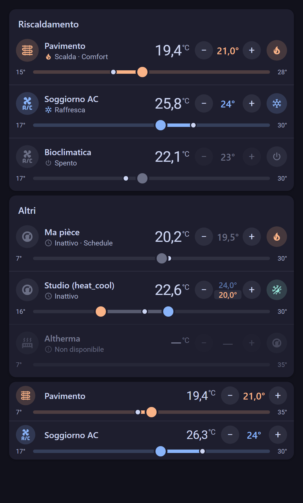
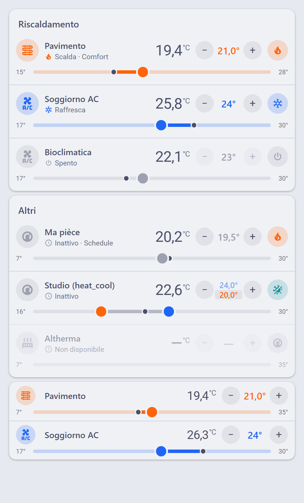

# Compact Thermostat Card

[](https://hacs.xyz)
[](https://github.com/arozoire/compact-thermostat-card/actions/workflows/build.yml)

Card Lovelace per Home Assistant che mostra **più termostati in righe compatte**, una sotto l'altra.
Si capisce lo stato a colpo d'occhio come nella card termostato nativa, ma occupa molto meno spazio:
4–5 termostati stanno in una schermata del telefono.

| Tema scuro | Tema chiaro |
| --- | --- |
|  |  |

## Cosa mostra ogni riga

- **Badge colorato** con l'icona dell'entità: arancione = scalda, blu = raffresca, grigio = inattivo o spento
  (colore da `hvac_action`, con fallback su `hvac_mode`).
- **Nome e stato** ("Scalda", "Raffresca", "Inattivo", "Spento"), con il preset se presente ("Scalda · Comfort").
- **Temperatura attuale** in grande.
- **Setpoint con − / +**: il passo è `target_temp_step` dell'entità. La chiamata a `climate.set_temperature`
  parte 1,5 s dopo l'ultimo tocco; nel frattempo il valore è evidenziato con una barra di attesa.
- **Pulsante modo**: colore e icona del modo attuale; al tocco apre il menu con gli `hvac_modes` e, se l'entità li
  supporta, i preset. Mentre HA applica il cambio, un anello gira attorno al pulsante.
- **Barra orizzontale**: pallino grande = setpoint, pallino piccolo = temperatura attuale, tratto pieno tra i due
  quando l'impianto sta lavorando. **Il pallino del setpoint si trascina** (mouse o dito) oppure si tocca un punto della
  barra; durante il trascinamento una bolla mostra il valore.
- Entità in `heat_cool` con `target_temp_low` / `target_temp_high`: due pallini (arancione = minimo, blu = massimo).
  Si trascina quello più vicino; con − / + si regola quello selezionato (tocca il valore per sceglierlo).
- Entità `unavailable` / `unknown`: riga grigia e controlli disabilitati. Da spento il setpoint resta visibile ma bloccato.
- Tocco su icona o nome: apre il more-info nativo.

I colori vengono solo dalle variabili CSS di Home Assistant (`--state-climate-heat-color`,
`--state-climate-cool-color`, `--primary-text-color`, …): la card segue il tema attivo, chiaro o scuro.

## Installazione

### HACS (repository personalizzato)

1. In Home Assistant apri **HACS**.
2. Menu ⋮ in alto a destra → **Repository personalizzati**.
3. Repository: `https://github.com/arozoire/compact-thermostat-card` — Tipo: **Dashboard** → **Aggiungi**.
4. Cerca **Compact Thermostat Card** in HACS → **Scarica**.
5. Ricarica il browser (o svuota la cache dell'app). HACS aggiunge da solo la risorsa
   `/hacsfiles/compact-thermostat-card/compact-thermostat-card.js`.

### Manuale

1. Scarica `compact-thermostat-card.js` dall'ultima [release](https://github.com/arozoire/compact-thermostat-card/releases).
2. Copialo in `/config/www/compact-thermostat-card.js`.
3. **Impostazioni → Dashboard → ⋮ → Risorse → Aggiungi risorsa**: URL `/local/compact-thermostat-card.js`,
   tipo **Modulo JavaScript**.

## Configurazione

La card ha un editor visuale (lista termostati con aggiungi, riordina, rimuovi). In YAML:

```yaml
type: custom:compact-thermostat-card
title: Riscaldamento
entities:
  - entity: climate.riscaldamento_pavimento
    name: Pavimento
    icon: mdi:heating-coil
    bar_min: 15
    bar_max: 28
  - entity: climate.ac_19621004
    name: Soggiorno AC
    current_sensor: sensor.temperatura_soggiorno
  - climate.bioclimatica
```

### Opzioni della card

| Opzione | Tipo | Default | Descrizione |
| --- | --- | --- | --- |
| `entities` | lista | **obbligatoria** | Termostati da mostrare, uno per riga. Si può scrivere anche solo l'`entity_id`. |
| `title` | testo | — | Titolo sopra le righe. |
| `show_mode_button` | bool | `true` | Mostra il pulsante del modo (con menu modi e preset). |
| `show_setpoint_buttons` | bool | `true` | Mostra i pulsanti − / + (la barra resta trascinabile). |
| `compact` | bool | `false` | Nasconde la riga di stato e riduce l'altezza (circa 66 px invece di 92 px per riga). |

### Opzioni per entità

| Opzione | Tipo | Default | Descrizione |
| --- | --- | --- | --- |
| `entity` | `climate.*` | **obbligatoria** | Il termostato. |
| `name` | testo | `friendly_name` | Nome mostrato. |
| `icon` | icona | icona dell'entità o `mdi:thermostat` | Icona nel badge. |
| `current_sensor` | `sensor.*` | — | Sensore da usare al posto di `current_temperature`. |
| `bar_min` / `bar_max` | numero | `min_temp` / `max_temp` | Estremi della barra. Utile quando l'entità ha un intervallo molto ampio (es. 7–35 °C) e si vuole un trascinamento più preciso. Il setpoint resta comunque limitato a `min_temp`–`max_temp`. |

## Esempi

Tutti i termostati di casa, compatti, senza pulsante modo:

```yaml
type: custom:compact-thermostat-card
compact: true
show_mode_button: false
entities:
  - climate.riscaldamento_pavimento
  - climate.ma_piece
  - climate.ac_19621004
  - climate.bioclimatica
```

Solo barra trascinabile, senza − / +:

```yaml
type: custom:compact-thermostat-card
title: Clima
show_setpoint_buttons: false
entities:
  - entity: climate.ma_piece
    bar_min: 16
    bar_max: 24
```

## Dashboard a sezioni

La card implementa `getGridOptions()`: larghezza predefinita 12 colonne, altezza calcolata dal numero di righe
(e dal titolo). Se le dai più spazio, le righe si allargano in modo uniforme. La larghezza la decide la dashboard;
sotto i 420 px la card riduce un po' badge, pulsanti e testo.

## Sviluppo

```bash
npm install
npm run check      # typecheck + build + verifica del bundle
npm run watch      # build continua
python -m http.server 8766   # poi apri http://localhost:8766/preview/
```

`preview/index.html` carica `dist/compact-thermostat-card.js` con un `hass` simulato (entità di esempio, chiamate di
servizio registrate in fondo alla pagina). Il bundle in `dist/` è committato: la CI controlla che corrisponda al sorgente.

Per una release: aggiorna `version` in `package.json`, committa, poi crea e pubblica il tag `vX.Y.Z`;
la GitHub Action allega `compact-thermostat-card.js` alla release.

## Licenza

MIT
